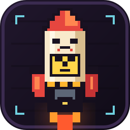

# 超级大宝贝



> 在 DeepSeek Harness 桌面端左下角的账户头像上方，放一枚会蓄力、会震动、会放音效的像素核导弹。

> [!WARNING]
> 连续点击 5 下蓄满后，动画结束会**真的退出 DeepSeek Harness**，并结束它的后台子进程。没有二次确认，请先保存工作。

## 效果

- 每点一次，导弹震动一下，模型放大 20%，并播放一层比一层高的蓄力音；
- 停手后，每 0.8 秒缩小一档（20%），直到恢复到原始大小；
- 连续点到第 5 下，模型达到原始大小的 2 倍，短暂停留后发射；
- 导弹点火、喷出像素尾焰，先冲到窗口左上角鲸鱼图标附近悬停锁定；
- 随后沿抛物线俯冲，砸进窗口正中心；
- 爆炸范围比初版大 20%，包含白光、冲击波、像素蘑菇云、碎片和整个应用视口的剧烈抖动；
- 爆炸结束后，Host 结束 Electron 主进程，Harness 及后台任务一起退出。

## 音效

音效全部由 Web Audio 实时合成，没有外部音频素材：

- **蓄力**：低频鼓点 + 机械脆响 + 随等级升高的能量音；
- **蓄满**：充能和弦、上扬噪声和高频裂响；
- **发射**：点火闷响、火箭轰鸣、左右声道交错的破空声，以及俯冲呼啸；
- **爆炸**：高频裂响、极低频冲击、中频胸腔冲击、宽频噪声、立体声碎裂、长尾隆隆声和二次余震。

主音轨带 tanh 饱和与限幅，小音箱上也能听到明显的中高频冲击，同时避免硬削波。

## 安装

仓库克隆到本地：

```bash
git clone https://github.com/Anonymity606/super-baby.git
```

然后在 DeepSeek Harness 会话里，用内置的 `plugin_manager` 安装克隆目录的**绝对路径**：

```text
plugin_manager install_bundle <克隆目录的绝对路径>
```

或在本地安装时直接使用目录路径。安装完成后如果图标没有出现，完全退出桌面端再打开。

> 这是桌面端插件：退出动作依赖 Electron 主进程。Web 版只能播放动画，不能关闭外部浏览器。

## 使用

鼠标连续点击左下角导弹 5 下即可。中途停手会慢慢缩小；再次点击会从当前档位继续蓄力。

如果只是想调试动画、不想退出 Harness，把 `client.js` 与 `index.js` 顶部的两处 `QUIT_ENABLED` 同时改成 `false`，然后重载插件。

## 文件结构

```text
super-baby/
├── package.json          # bundle 与 dsh.client 声明
├── cordis.patch.yml      # Host 挂载行
├── index.js              # 鉴权退出路由与进程回收
├── client.js             # 蓄力、动画、音效、爆炸与窗口抖动
├── icon.svg              # 原创像素核导弹图标
├── locale/
│   ├── en.json           # 插件管理页英文文案
│   └── zh.json           # 插件管理页中文文案
└── README.md
```

## 安全边界

- 退出请求走 `POST /__nuke_baby/quit`，校验同源浏览器凭据和专用请求头；
- 没有暴露给智能体的工具，只有用户点击能触发；
- 桌面端结束的是 Electron 主进程，Harness Host、渲染进程和后台子进程随进程组退出；
- 这是不可撤销的退出操作，不弹二次确认。

## 兼容性

在 Windows 上的 DeepSeek Harness Desktop 0.2.x 中开发与验证。不同版本的宿主界面槽位或 Electron 进程结构可能变化，升级 Harness 后建议先在一份可丢弃的会话里确认退出行为。

## 声明

非官方同人项目，与 DeepSeek、凉屋游戏无关联。像素导弹图像为本项目原创，未使用《元气骑士》的游戏素材；“超级大宝贝”仅作为效果参考与插件名称。

## 许可证

MIT
